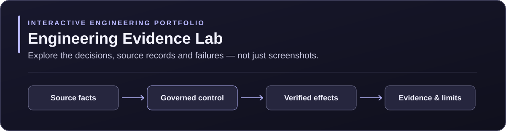

# Richard Butts

**Enterprise Systems Architecture · Data & Analytics Engineering · MarTech · Revenue Integrity · Applied AI**

I design and build systems that connect **CRM, operations, marketing and finance** with governed data, durable workflows and source-linked reporting. My work spans B2B SaaS, ecommerce, PE-backed and multi-business operating environments.

**What the code demonstrates:** canonical identity, field ownership, source provenance, temporal history, SQL/dbt modeling, idempotency, replay safety, audited decisions and measurable failure recovery. Public fixtures are synthetic or explicitly sourced samples; native Salesforce, Snowflake, BigQuery and AWS evidence is identified separately from local execution.

## Start here — interact with the engineering

**[Open the live Engineering Evidence Lab](https://rlbsem.github.io/enterprise-revenue-systems-lab/)** · [Browse its source code](https://github.com/rlbsem/enterprise-revenue-systems-lab)

Nine published, **read-only interactive investigations** make recorded evidence immediately inspectable without installing a development environment. The original engines, native vendor records, boundaries and reproduction instructions remain linked in source repositories.

**Explore a technical lane:** [Revenue integrity](https://rlbsem.github.io/enterprise-revenue-systems-lab/?case=revenue-integrity) · [Analytics Engineering](https://rlbsem.github.io/enterprise-revenue-systems-lab/?case=analytics-engineering) · [First-party measurement](https://rlbsem.github.io/enterprise-revenue-systems-lab/?case=measurement-integrity) · [AI release assurance](https://rlbsem.github.io/enterprise-revenue-systems-lab/?case=release-assurance) · [AI account intelligence](https://rlbsem.github.io/enterprise-revenue-systems-lab/?case=gtm-research)

## Engineering implementations

**13 engineering systems · four complementary disciplines.** These are substantive implementations, not rankings. Select a repository for source code, executed tests, evidence and limitations.

## Enterprise Architecture & Integration

How independently owned source systems become governed, reconcilable operating infrastructure.

<table>
<tr><td valign="top" width="50%">
<strong><a href="https://github.com/rlbsem/enterprise-acquisition-onboarding">Enterprise Acquisition Onboarding</a></strong>

Acquired-company identity, reviewed mappings and source-to-finance reconciliation across three synthetic companies; runnable PostgreSQL/dbt/Docker console.

<a href="https://github.com/rlbsem/enterprise-acquisition-onboarding/blob/main/docs/annual-scenario.md">Annual finance evidence</a> · <a href="https://github.com/rlbsem/enterprise-acquisition-onboarding">Code &amp; documentation</a>
</td><td valign="top" width="50%">
<strong><a href="https://github.com/rlbsem/enterprise-revenue-integrity-platform">Enterprise Revenue Integrity Platform</a></strong>

Executable order-to-cash control layer with independent receipt recovery; retains a synthetic $1,500 ERP posting variance.

<a href="https://rlbsem.github.io/enterprise-revenue-systems-lab/?case=revenue-integrity">Interactive investigation</a> · <a href="https://github.com/rlbsem/enterprise-revenue-integrity-platform">Code &amp; documentation</a>
</td></tr>
<tr><td valign="top" width="50%">
<strong><a href="https://github.com/rlbsem/enterprise-martech-ai-control-plane">Enterprise MarTech / AI Control Plane</a></strong>

PostgreSQL-governed identity, approvals, field ownership and recoverable delivery; includes measured dependency-isolation tests.

<a href="https://github.com/rlbsem/enterprise-martech-ai-control-plane/blob/main/docs/evidence/dependency-isolation/arrival-review/README.md">Executed stress evidence</a> · <a href="https://github.com/rlbsem/enterprise-martech-ai-control-plane">Code &amp; documentation</a>
</td><td valign="top" width="50%">
<strong><a href="https://github.com/rlbsem/customer-signal-activation">Customer Signal &amp; Activation</a></strong>

Source-aware customer activation, lifecycle orchestration and experiments; includes recorded native Salesforce–Snowflake readback.

<a href="https://github.com/rlbsem/customer-signal-activation/blob/main/docs/evidence/connected-integration/README.md">Native integration evidence</a> · <a href="https://github.com/rlbsem/customer-signal-activation">Code &amp; documentation</a>
</td></tr>
</table>

## Data, Analytics & MarTech Engineering

How events, contracts and SQL models preserve grain, time, provenance and source authority.

<table>
<tr><td valign="top" width="50%">
<strong><a href="https://github.com/rlbsem/revenue-metrics-platform">Revenue Metrics Platform</a></strong>

Governed financial metrics, 15 dbt models, full rowset parity and measured 60K/180K synthetic-account performance.

<a href="https://rlbsem.github.io/enterprise-revenue-systems-lab/?case=analytics-engineering">Interactive SQL &amp; benchmarks</a> · <a href="https://github.com/rlbsem/revenue-metrics-platform">Code &amp; documentation</a>
</td><td valign="top" width="50%">
<strong><a href="https://github.com/rlbsem/first-party-measurement-assurance">First-Party Measurement Assurance</a></strong>

Consent-aware measurement and offline conversion reconciliation; separately records genuine BigQuery public-sample queries.

<a href="https://rlbsem.github.io/enterprise-revenue-systems-lab/?case=measurement-integrity">Interactive investigation</a> · <a href="https://github.com/rlbsem/first-party-measurement-assurance">Code &amp; documentation</a>
</td></tr>
<tr><td valign="top" width="50%">
<strong><a href="https://github.com/rlbsem/martech-migration-assurance">MarTech Migration Assurance</a></strong>

Native PostgreSQL logical replication with snapshot-to-WAL handoff, guarded cutover and fault/restart verification.

<a href="https://github.com/rlbsem/martech-migration-assurance/blob/main/docs/evidence/postgres-cdc/report.md">Native CDC evidence</a> · <a href="https://github.com/rlbsem/martech-migration-assurance">Code &amp; documentation</a>
</td><td valign="top" width="50%">
<strong><a href="https://github.com/rlbsem/martech-data-reliability">MarTech Data Reliability</a></strong>

Schema and source-contract validation with quarantine, correction handling and publication controls for reliable analytics.

<a href="https://github.com/rlbsem/martech-data-reliability">Implementation &amp; tests</a> · <a href="https://github.com/rlbsem/martech-data-reliability">Code &amp; documentation</a>
</td></tr>
<tr><td valign="top" width="50%">
<strong><a href="https://github.com/rlbsem/temporal-customer-audiences">Temporal Customer Audiences</a></strong>

Bitemporal audience modeling that preserves historical eligibility when late facts and corrections change what was known.

<a href="https://github.com/rlbsem/temporal-customer-audiences">Models &amp; reproducibility</a> · <a href="https://github.com/rlbsem/temporal-customer-audiences">Code &amp; documentation</a>
</td><td width="50%" valign="top"></td></tr>
</table>

## AI & GTM Engineering

How intelligence becomes an accountable business action—and how model releases remain controlled.

<table>
<tr><td valign="top" width="50%">
<strong><a href="https://github.com/rlbsem/gtm-pipeline-orchestration">GTM Pipeline Orchestration</a></strong>

AI-assisted account prioritization and accountable sales handoff, with real Qwen3 evaluations and separate native Salesforce evidence.

<a href="https://rlbsem.github.io/enterprise-revenue-systems-lab/?case=gtm-research">Interactive account intelligence</a> · <a href="https://github.com/rlbsem/gtm-pipeline-orchestration">Code &amp; documentation</a>
</td><td valign="top" width="50%">
<strong><a href="https://github.com/rlbsem/enterprise-agent-runtime-evaluation">Enterprise Agent Runtime &amp; Evaluation</a></strong>

Actual local Qwen3 inference, rejected candidate evidence and tested shadow/canary/promotion/rollback across synthetic tasks.

<a href="https://rlbsem.github.io/enterprise-revenue-systems-lab/?case=release-assurance">Interactive release evidence</a> · <a href="https://github.com/rlbsem/enterprise-agent-runtime-evaluation">Code &amp; documentation</a>
</td></tr>
</table>

## Platform Governance & Economics

How to change the systems estate without relying on unsupported impact or cost assumptions.

<table>
<tr><td valign="top" width="50%">
<strong><a href="https://github.com/rlbsem/martech-estate-impact">MarTech Estate Impact</a></strong>

Dependency and impact analysis for platform consolidation; unresolved dependencies remain visible instead of becoming assumed savings.

<a href="https://github.com/rlbsem/martech-estate-impact">Explore architecture</a> · <a href="https://github.com/rlbsem/martech-estate-impact">Code &amp; documentation</a>
</td><td valign="top" width="50%">
<strong><a href="https://github.com/rlbsem/martech-stack-economics">MarTech Stack Economics</a></strong>

Constrained architecture-cost decisions that weigh spending, API quotas, capacity and freshness rather than price alone.

<a href="https://github.com/rlbsem/martech-stack-economics">Optimization implementation</a> · <a href="https://github.com/rlbsem/martech-stack-economics">Code &amp; documentation</a>
</td></tr>
</table>

## Architecture & verification evidence

<strong>View the full enterprise capability map</strong>

[Open the full-size SVG](assets/capability-map.svg). The map groups related capabilities; it is not a claim that the repositories are one production deployment.

<strong>Selected execution evidence — native systems, failure recovery and independent checks</strong>

- [Native Salesforce ↔ Snowflake handoff](https://github.com/rlbsem/customer-signal-activation/blob/main/docs/evidence/connected-integration/README.md): governed CRM action, uncertain acknowledgment, independent record readback and warehouse feedback.
- [Historical native BigQuery results](https://github.com/rlbsem/first-party-measurement-assurance/blob/main/docs/evidence/google-bigquery/README.md): executed public GA4 sample queries; separate from the synthetic contract/payment scenario.
- [Native PostgreSQL CDC](https://github.com/rlbsem/martech-migration-assurance/blob/main/docs/evidence/postgres-cdc/report.md): snapshot/WAL boundary, recovery and cutover safety.
- [Local Qwen model release](https://github.com/rlbsem/enterprise-agent-runtime-evaluation/blob/main/docs/live-release-acceptance.md): preserved failures, finite-suite acceptance, shadow/canary and verified rollback.
- [PE acquisition financial governance](https://github.com/rlbsem/enterprise-acquisition-onboarding/blob/main/docs/annual-scenario.md): synthetic original/restated reporting, held entities and explicit unresolved exceptions.
- [Measured warehouse performance](https://github.com/rlbsem/revenue-metrics-platform/blob/main/docs/performance.md): reconciled SQL/dbt outputs and a rejected slower optimization.
- [Control-plane dependency isolation](https://github.com/rlbsem/enterprise-martech-ai-control-plane/blob/main/docs/evidence/dependency-isolation/arrival-review/README.md): admission, overload rejections and observed downstream effects.

<strong>Platforms, engineering technologies and architectural controls</strong>

**Business platforms:** Salesforce · HubSpot · Salesforce Marketing Cloud / Pardot · Marketo · Segment · Clay · LMN · Aspire · QuickBooks · NetSuite · GA4 / GTM · Adobe Analytics · Tableau

**Engineering:** Python · SQL · JavaScript / TypeScript · PostgreSQL · Snowflake · BigQuery · Supabase · dbt · DuckDB · FastAPI · Airflow · Docker · GitHub Actions · AWS · REST APIs · Webhooks

**Design and reliability:** Canonical identity · Source-of-truth governance · Field ownership · SCD Type 2 · Bitemporal modeling · Data contracts · ETL/ELT · Incremental processing · No-Regress Logic · Idempotency · Durable outbox · Retry/exception queues · RBAC · Consent governance · Audit logs · Revenue reconciliation · LLM evaluation

**Engineering standard:** Tools execute. The control layer determines what is true.

