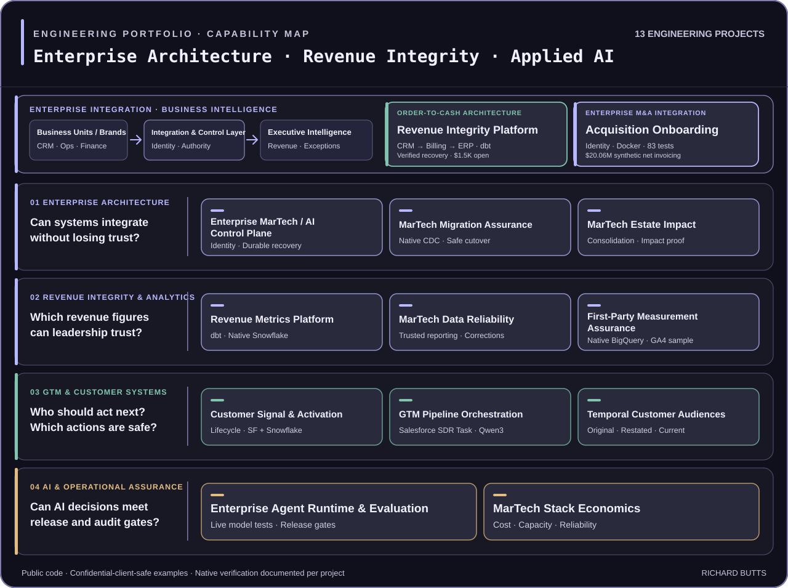

# Richard Butts

**AI GTM Engineering · Enterprise Data & Systems Architecture · Applied AI · Revenue Integrity · MarTech**

I architect and deliver enterprise data infrastructure, stateful integration control layers, revenue integrity systems and AI-enabled GTM workflows for **private equity sponsors, multi-brand operating companies and enterprise teams**. My client work includes connecting acquired businesses to shared portfolio infrastructure while preserving their existing CRM, operations and finance systems, canonical identities, source authority, audit trails and reconciled reporting. I implement these systems with Python, SQL, PostgreSQL, APIs, dbt and governed controls for field ownership, No-Regress Logic, idempotency and recoverable execution.

**Engineering evidence:** The repositories below demonstrate capabilities applied in real client environments through executable code, tests and recorded integration evidence, including **native Salesforce, Snowflake and BigQuery acceptance** and **actual local LLM inference**. Public implementations use synthetic or sample data to protect confidential business information; public test scenarios and their measured outcomes are not represented as specific client deployments.

**Explore by engineering focus:**

- **AI & GTM engineering:** [GTM Pipeline Orchestration](https://github.com/rlbsem/gtm-pipeline-orchestration) · [Enterprise Agent Runtime & Evaluation](https://github.com/rlbsem/enterprise-agent-runtime-evaluation) · [Interactive SDR Account Intelligence](https://rlbsem.github.io/enterprise-revenue-systems-lab/?case=gtm-research)
- **MarTech & enterprise integration:** [Enterprise MarTech / AI Control Plane](https://github.com/rlbsem/enterprise-martech-ai-control-plane) · [Customer Signal & Activation](https://github.com/rlbsem/customer-signal-activation) · [MarTech Migration Assurance](https://github.com/rlbsem/martech-migration-assurance)
- **Data & analytics engineering:** [Revenue Metrics Platform](https://github.com/rlbsem/revenue-metrics-platform) · [First-Party Measurement Assurance](https://github.com/rlbsem/first-party-measurement-assurance) · [MarTech Data Reliability](https://github.com/rlbsem/martech-data-reliability)

**Explore without installing software:** [Open the hosted Engineering Evidence Lab](https://rlbsem.github.io/enterprise-revenue-systems-lab/). Its six interactive investigations cover AI model release assurance, governed seller actions, GTM account intelligence, failure recovery, revenue reconciliation and native CRM/warehouse evidence. [Inspect the AI Model Release Assurance investigation](https://rlbsem.github.io/enterprise-revenue-systems-lab/?case=release-assurance) to follow recorded Qwen3 model evaluation, shadow/canary decisions, promotion and verified rollback. The hosted site is read-only; executing fresh inference or the underlying applications requires their separate local workflows.

**Featured AI release proof:** [Enterprise Agent Runtime & Evaluation](https://github.com/rlbsem/enterprise-agent-runtime-evaluation) ran actual local **Qwen3-14B** inference, completed **48/48 synthetic tasks per configuration**, and exercised shadow evaluation, read-only canary, local promotion, controlled-fault detection and verified rollback. **79 tests passed** with Windows/Linux CI. These are finite-suite local results with synthetic effects, not production claims. [Explore the interactive release investigation](https://rlbsem.github.io/enterprise-revenue-systems-lab/?case=release-assurance) · [Executed release assessment](https://github.com/rlbsem/enterprise-agent-runtime-evaluation/blob/main/docs/live-release-acceptance.md) · [Self-contained evidence review](https://github.com/rlbsem/enterprise-agent-runtime-evaluation/blob/main/docs/release-review.html)

## Engineering Implementations & Evidence

Five projects with detailed code, test results, and execution evidence.

**1. [GTM Pipeline Orchestration](https://github.com/rlbsem/gtm-pipeline-orchestration)**

This Python GTM application covers AI account research, fit/intent prioritization, inbound owner-routing, approved seller actions, failure recovery and qualified-pipeline measurement. The **SDR account-intelligence desk** exposes dated source evidence, explainable account priorities, conflicting fixture enrichment, editable outreach openings and durable local approvals/dismissals. It retains **40 actual Qwen3-14B evaluation responses across three prompt approaches**, including preserved failures, plus a separate fresh source-to-inference-to-local-approval demonstration. The latest verification reports **237 passing tests** and Linux, Windows and container CI.

A **separate connected native Salesforce Developer Edition run** took a synthetic buying signal through **fresh Qwen3 inference → exact operator review → one guarded internal Salesforce SDR Task → independent readback**, including lost-acknowledgment recovery. The research desk's approvals are local; native Salesforce Task execution is evidenced separately. Clay enrichment uses fixture providers, while n8n is a documented reference workflow. The **120-account, USD $3.46M qualified-pipeline scenario** is synthetic and demonstrates measurement rather than client revenue.

[Research architecture and evaluation](https://github.com/rlbsem/gtm-pipeline-orchestration/blob/main/docs/account-intelligence.md) · [Recorded Qwen3 evaluations](https://github.com/rlbsem/gtm-pipeline-orchestration/blob/main/docs/evidence/research/README.md) · [Fresh operator proof](https://github.com/rlbsem/gtm-pipeline-orchestration/blob/main/docs/evidence/research/operator-proof.json) · [Connected native Salesforce execution](https://github.com/rlbsem/gtm-pipeline-orchestration/blob/main/docs/connected-sdr.md) · [Native Task and recovery evidence](https://github.com/rlbsem/gtm-pipeline-orchestration/blob/main/docs/evidence/connected/README.md) · [Synthetic pipeline demo](https://github.com/rlbsem/gtm-pipeline-orchestration/blob/main/docs/evidence/enterprise-usd/README.md) · [GTM verification (main)](https://github.com/rlbsem/gtm-pipeline-orchestration/actions/workflows/verify.yml?query=branch%3Amain)

**2. [Customer Signal & Activation](https://github.com/rlbsem/customer-signal-activation)**

This Python/SQL platform connects customer signals to governed CRM decisions, preserving identity, person-level permissions, account ownership, approved actions and fulfillment-to-cash lineage. In an **executed Salesforce ↔ Snowflake round-trip**, it recovered an uncertain Salesforce acknowledgment without duplicating the record; independent readback confirmed the action, and CRM feedback changed the subsequent warehouse recommendation.

Its **lifecycle orchestration and experimentation layer** now coordinates trial onboarding, quiet-trial assistance and expansion education with durable timers, cross-journey contact arbitration, enforced treatment/holdout assignments, late-correction-safe metrics and independent HTTP receipt recovery. The implementation verifies **443 tests across the completed local suite**, with successful Linux/Windows CI, **nine dbt models and 13 data tests**. The experiment data and commercial outcomes are synthetic; this is verified engineering behavior, not a claimed customer uplift.

[Lifecycle architecture and executed proof](https://github.com/rlbsem/customer-signal-activation/blob/main/docs/lifecycle-execution-evidence.md) · [Experiment measurement contract](https://github.com/rlbsem/customer-signal-activation/blob/main/docs/lifecycle-experiments.md) · [Native Salesforce–Snowflake evidence](https://github.com/rlbsem/customer-signal-activation/blob/main/docs/evidence/connected-integration/README.md) · [Salesforce authorization and recovery tests](https://github.com/rlbsem/customer-signal-activation/blob/main/docs/evidence/salesforce-native/README.md)

**3. [Enterprise MarTech / AI Control Plane](https://github.com/rlbsem/enterprise-martech-ai-control-plane)**

This Python/PostgreSQL control plane governs canonical identity, field ownership, consent, approvals and durable downstream actions. Its **dependency-isolation acceptance** offered 20,000 synthetic proposals across four five-minute local HTTP runs: **12,035 admitted actions** each reconciled to one effect, while **7,965 overload rejections** were explicitly accounted for. PostgreSQL-coordinated destination permits, bounded queues and recovery checks kept an unhealthy receiver from monopolizing shared workers. Permit issuance stayed within 10 per destination per assigned second; actual receiver arrivals sometimes reached 11, so this is **not a strict provider-arrival rate guarantee**. Separate historical native AWS tests verified receipts, restricted permissions and an RDS restore reaching `available`; final restored application-state validation remains unverified.

[Measured dependency isolation and receiver-rate evidence](https://github.com/rlbsem/enterprise-martech-ai-control-plane/blob/main/docs/evidence/dependency-isolation/arrival-review/README.md) · [AWS execution boundary](https://github.com/rlbsem/enterprise-martech-ai-control-plane/blob/main/docs/evidence/aws-readiness/retained-two-instance/native-outcome/README.md) · [Recovery tests](https://github.com/rlbsem/enterprise-martech-ai-control-plane/blob/main/docs/evidence/report.md) · [Architecture](https://github.com/rlbsem/enterprise-martech-ai-control-plane/blob/main/docs/architecture.md)

**4. [Revenue Metrics Platform](https://github.com/rlbsem/revenue-metrics-platform)**

Bookings, invoices, collected cash and period-end ARR have different grains and reporting semantics. This Python/SQL/dbt platform reconciles six governed measures across historical CRM, subscription and financial events. **Controlled local enterprise and stress benchmarks** executed at 60,000 and 180,000 synthetic accounts, including a **37.38-million-row** opportunity-day fact. **87 Python tests, 30 dbt tests and complete content comparisons across all 15 models** verified financial parity. Selective rebuilding sped up a targeted aggregation but made total corrected runs **54.3% and 31.2% slower** respectively; the faster original remains the default. Historical native Snowflake fixture acceptance passed on an earlier model version; no fresh cloud or production performance claim is made.

[Measured performance and parity report](https://github.com/rlbsem/revenue-metrics-platform/blob/main/docs/evidence/performance/report.md) · [Reproduction and implementation limits](https://github.com/rlbsem/revenue-metrics-platform/blob/main/docs/performance.md) · [Historical Snowflake execution evidence](https://github.com/rlbsem/revenue-metrics-platform/blob/main/docs/evidence/snowflake/fixture/README.md)

**5. [First-Party Measurement Assurance](https://github.com/rlbsem/first-party-measurement-assurance)**

Attribution breaks when browser events are lost or sales milestones are treated as collected revenue. This implementation combines consent-aware events, GTM data layers, durable offline conversion receipts and SQL/dbt reconciliation. **Native BigQuery queries** against Google's public GA4 sample distinguished 14 purchase events from 57 nested item rows and retained two revenue discrepancies. The Google sample and local synthetic business scenarios are documented separately.

A separate [local GA4 warehouse module](https://github.com/rlbsem/first-party-measurement-assurance/blob/main/docs/evidence/ga4-warehouse/README.md) verifies late corrections, replay safety and incremental/full-refresh parity.

[BigQuery execution evidence](https://github.com/rlbsem/first-party-measurement-assurance/blob/main/docs/evidence/google-bigquery/README.md) · [Measurement verification (main)](https://github.com/rlbsem/first-party-measurement-assurance/actions/workflows/verify.yml?query=branch%3Amain)

## Six Additional Engineering Systems

Six more projects cover specific problems in data reliability, migrations, temporal history, AI evaluation, and platform governance.

- **[MarTech Data Reliability](https://github.com/rlbsem/martech-data-reliability):** Contract-checked ingestion, quarantine and correction handling keep invalid loads from replacing validated reporting data.
- **[MarTech Migration Assurance](https://github.com/rlbsem/martech-migration-assurance):** Real local **PostgreSQL `pgoutput` CDC** with an exported snapshot-to-WAL boundary, native logical replication, durable semantic checkpoints, guarded cutover and crash/restart recovery across different schemas. **70 tests and 13 native fault scenarios** were verified; unsupported or unsafe continuity cases block rather than silently replay. [Executed native acceptance](https://github.com/rlbsem/martech-migration-assurance/blob/main/docs/evidence/postgres-cdc/report.md).
- **[Temporal Customer Audiences](https://github.com/rlbsem/temporal-customer-audiences):** Business-time and knowledge-time history account for late-arriving facts, corrected eligibility and auditable past decisions.
- **[Enterprise Agent Runtime & Evaluation](https://github.com/rlbsem/enterprise-agent-runtime-evaluation):** Real Qwen3-14B inference with independent outcome/effect checks, preserved rejected attempts, **48/48 tasks per paired configuration**, and an executed shadow → canary → promotion → fault/rollback lifecycle. [Read the acceptance evidence](https://github.com/rlbsem/enterprise-agent-runtime-evaluation/blob/main/docs/live-release-acceptance.md).
- **[MarTech Estate Impact](https://github.com/rlbsem/martech-estate-impact):** Dependency evidence and explicit uncertainty make platform retirement and consolidation decisions inspectable.
- **[MarTech Stack Economics](https://github.com/rlbsem/martech-stack-economics):** Constrained optimization tests proposed savings against cost, freshness, capacity and API quotas.

### Architecture capability map

Where the projects fit across revenue systems, integration controls, enterprise architecture, and AI:

[View the full-size diagram](assets/capability-map.svg).

## Explore engineering in action

**[Enterprise Revenue Systems Lab](https://rlbsem.github.io/enterprise-revenue-systems-lab/): interactive evidence explorer** · [Source code](https://github.com/rlbsem/enterprise-revenue-systems-lab)

The interactive lab lets you walk through six investigations:

- **AI model release assurance:** [Explore the recorded Qwen3 release progression](https://rlbsem.github.io/enterprise-revenue-systems-lab/?case=release-assurance): original Qwen2.5 failures, rejected 35/36 candidate, paired 48/48 finite-suite acceptance, actual local shadow/canary/promotion and controlled-fault rollback. Inspect pinned model traces, independent receipts and evidence limitations; all effects are synthetic.
- **AI seller decisions:** Examine a model-generated recommendation, its supporting sources, a reviewed edit, approval and recorded delivery evidence.
- **Execution recovery:** Trace a lost acknowledgment and worker interruption through durable workflow state and independent receiver receipts, including duplicate prevention.
- **Revenue reconciliation:** Explore why installed ARR, bookings, invoices and collected cash differ, with a source-backed financial bridge.
- **Native Salesforce and Snowflake:** [Inspect the CRM-to-warehouse round trip](https://rlbsem.github.io/enterprise-revenue-systems-lab/?case=connected-roundtrip), including source authority, lost-acknowledgment recovery, independent CRM readback and the resulting warehouse decision.
- **AI account intelligence to qualified pipeline:** [Explore the hosted SDR Account Intelligence investigation](https://rlbsem.github.io/enterprise-revenue-systems-lab/?case=gtm-research): six synthetic research accounts, 40 recorded Qwen3 responses, evidence-grounded recommendations, rejected outputs and saved local seller-review proof. [Explore the separate pipeline investigation](https://rlbsem.github.io/enterprise-revenue-systems-lab/?case=gtm-enterprise) for synthetic opportunity measurement and earlier native Salesforce evidence. The richer research did not execute through Salesforce; the separate connected Qwen3-to-Salesforce Task proof remains in the [source GTM repository](https://github.com/rlbsem/gtm-pipeline-orchestration/blob/main/docs/connected-sdr.md).

The hosted lab uses recorded **synthetic evidence**, not live production data. Running the underlying engines or fresh model inference requires the separate local workflows.

## Systems, technologies, and control patterns

**Enterprise platforms and business systems:** Salesforce · HubSpot · Salesforce Marketing Cloud · Marketing Cloud Account Engagement (Pardot) · Marketo · Segment · Clay · LinkedIn Sales Navigator · HighLevel (GoHighLevel) · LMN · Aspire · QuickBooks · Google Analytics 4 (GA4) · Google Tag Manager (GTM) · Adobe Analytics · Tableau · Power BI · Vapi · Dialpad · Make · n8n · Workato · Zapier

**Engineering, data platforms, and cloud:** Python · SQL · JavaScript / TypeScript · PostgreSQL · Snowflake · Supabase · dbt · DuckDB · SQLite · FastAPI · Streamlit · Airflow · Git · GitHub Actions / CI/CD · Docker · Terraform · AWS architecture (ECS/Fargate, RDS, ECR, IAM/OIDC)

**Data architecture and enterprise integration:** Dimensional modeling · SCD Type 2 · Bitemporal data · Governed metrics · Data contracts · Schema evolution · ETL / ELT · Reverse ETL / warehouse-to-CRM activation · Incremental processing · Backfills · REST APIs · Webhooks · OAuth 2.0 · Canonical identity · Entity resolution · Source lineage · GTM engineering · Lead scoring and routing · SDR/AE workflow automation · Sales engagement systems · Pipeline attribution · Meta Conversions API · Google Enhanced Conversions · Offline conversion tracking · Server-side measurement

**Reliability, governance, and AI systems:** Source authority · Field ownership · No-Regress Logic · Stateful middleware · Idempotency · Replay safety · Retry/backoff · Exception queues · RBAC · Consent governance · Audit logging · Revenue reconciliation · Failure recovery · Release gates · OpenAI / LLM APIs · Anthropic Claude · Qwen local inference · llama.cpp · Model Context Protocol (MCP) · Prompt engineering · Tool/function calling · Structured outputs · LLM evaluation · Human approval controls

## How to evaluate the work

Each repository documents its code, tests, and limits. The examples use synthetic or vendor-neutral data, and I distinguish native service execution from local tests and production deployment.

**Tools execute. The control layer determines what is true.**
